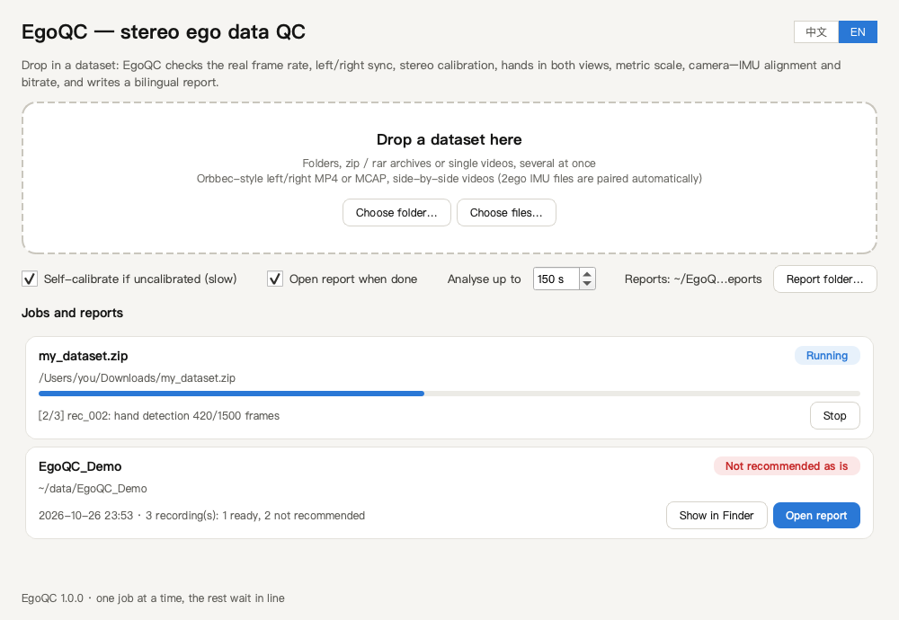
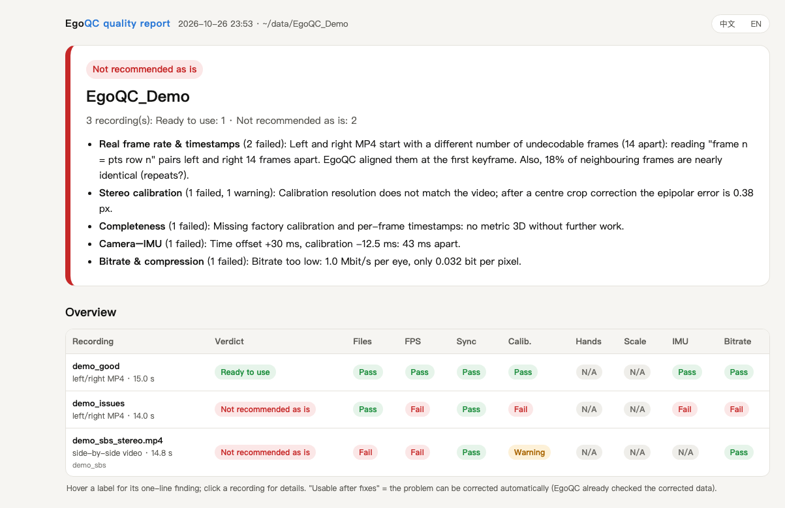
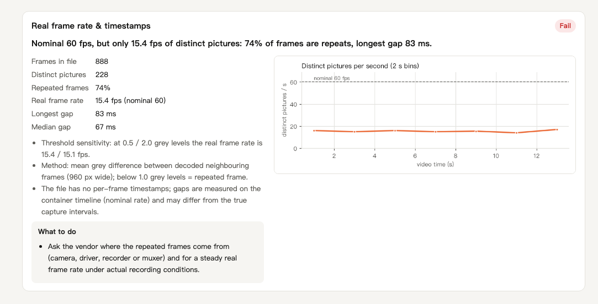
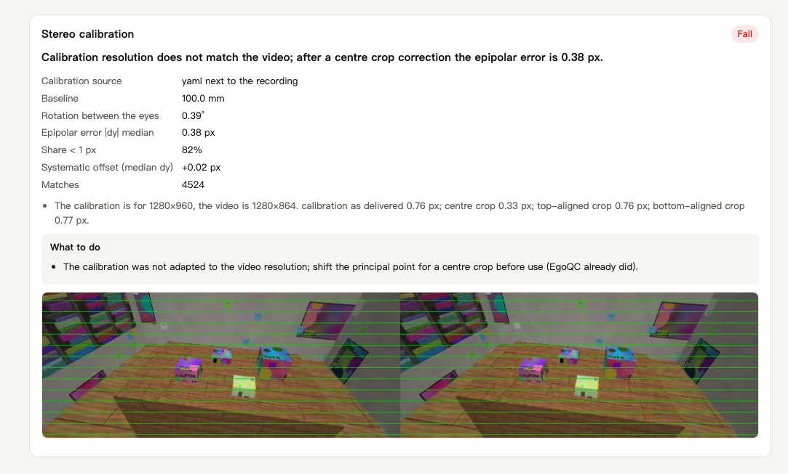
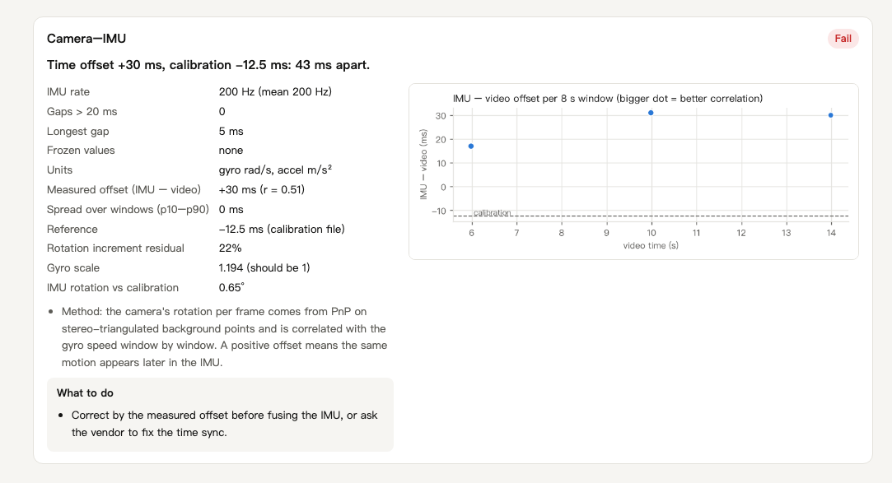
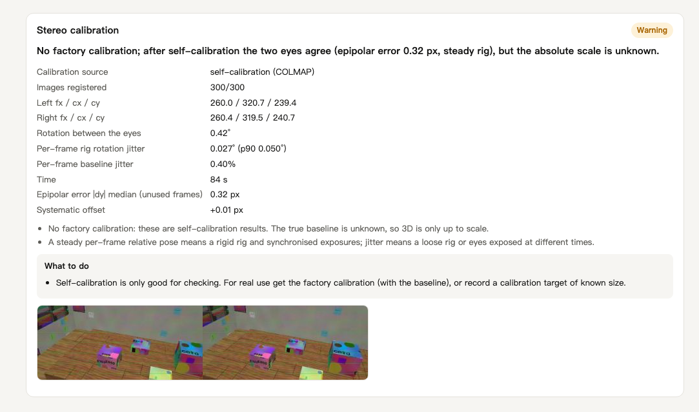

<p align="center"></p>

<h1 align="center">EgoQC</h1>
<p align="center"><b>Quality check for stereo egocentric datasets — drop a dataset in, get a verdict and a readable report.</b><br>
English · <a href="README.zh-CN.md">中文</a></p>

EgoQC checks what decides whether head-mounted stereo recordings are usable for learning hand and tool motion:
are the frames real, are left and right in sync, does the calibration fit the pixels, are the hands seen
consistently by both eyes, is the 3D scale right, and does the IMU line up in time. It measures all of this
from the recording itself instead of trusting the file's metadata, and writes one self-contained HTML report
per dataset, in Chinese and English (switch at the top right).



## What it catches

Problems that look fine in the metadata but break 3D hand/tool tracking:

- a "60 fps" video where most frames are repeats of the previous one
- left and right MP4 streams that a normal reader pairs several frames apart, because the files start before a keyframe
- a calibration made for 1920×1200 shipped with 1920×1080 video (the principal point is off by the crop)
- an IMU clock that is tens of milliseconds off the time offset in its calibration, or drifts
- bitrates so low that fingers and tool tips turn to mush

Each finding says what is wrong, shows the numbers behind it, and says what to ask the vendor for.

## The checks

| Check | How it is measured | Pass (tunable in `egoqc/config.py`) |
|---|---|---|
| Completeness | factory calibration, per-frame timestamps, IMU, metadata, label files | calibration and timestamps present |
| Real frame rate | distinct pictures: byte fingerprints (MJPEG) or decoded grey difference (H.264/H.265); gaps; undecodable leading frames | ≥ 95 % of nominal, longest gap ≤ 100 ms |
| Left/right sync | timestamp difference + cross-correlation of both views' motion; side-by-side: both halves update together | correlation peak at 0 frames |
| Stereo calibration | rectify with the calibration, vertical offset of SIFT matches (f = 500 px); tries crops when resolutions differ; COLMAP self-calibration when there is none | median ≤ 0.8 px, offset ≤ 0.4 px |
| Hands in both views | MediaPipe 21 keypoints in each view independently, epipolar agreement of the pairs | detected ≥ 90 %, clean pairs ≥ 60 % |
| Metric scale | triangulated palm length (wrist → middle knuckle) and its trend over depth | 7–10 cm, no shared trend > 10 % per 10 cm |
| Camera–IMU | camera rotation from PnP vs. gyro, window by window: time offset, drift, axes, gyro units | within 10 ms of the calibration, windows within 50 ms |
| Bitrate | bits per pixel per real picture | H.264 ≥ 0.08, MJPEG ≥ 0.30 |

Every recording gets a verdict: **Ready to use**, **Usable, with caveats**, **Usable after fixes** (the problem can
be corrected automatically and EgoQC already checked the corrected data), or **Not recommended as is**.

## The report

One HTML file per dataset (images embedded, easy to send), plus `report.json` for scripts. It opens with the
verdict and the main problems, then an overview with one row per recording:



Below that, one card per check with the numbers, a chart or picture, and what to do about it:

**Real frame rate** — a "60 fps" side-by-side video that holds 15 real pictures per second:



**Stereo calibration** — a calibration made for 1280×960 shipped with a 1280×864 crop; EgoQC finds the crop and
checks the corrected calibration (green lines: rectified rows should hit the same features in both eyes):



**Camera–IMU** — the IMU clock is 43 ms off the offset in its calibration:



**Self-calibration** — no calibration delivered; COLMAP recovers both lenses and the rig from the video:



<sub>Screenshots from the synthetic demo data below.</sub>

## Install (macOS)

```bash
git clone https://github.com/KowalskiWang/EgoQC.git
cd EgoQC
brew install ffmpeg
packaging/setup.sh
```

`setup.sh` creates a Python 3.12 environment in `.venv` (with [uv](https://github.com/astral-sh/uv) if you have
it), downloads the MediaPipe hand model and builds `~/Applications/EgoQC.app`. The app holds a copy of the code,
so run `packaging/make_app.sh` again after changing it. Tested on macOS 15 (Apple Silicon).

## Use

1. Open **EgoQC** and drag a dataset onto the window or the Dock icon: a folder, a zip / rar / 7z archive, or a
   single video. Several at once are fine; they run one after another.
2. Watch the progress; **Stop** cancels a job and removes its partial output.
3. The report opens when done (Reports go to `~/EgoQC_Reports`; change it with **Report folder…**). Past reports
   are listed in the window.

The first time EgoQC reads an external drive, macOS asks whether it may access removable volumes; allow it once
(or later in System Settings → Privacy & Security → Files and Folders).

### Command line (any OS with Python and ffmpeg)

```bash
python egoqc_cli.py <folder | archive | video> --out reports --lang en
```

| Option | |
|---|---|
| `--out DIR` | report folder (default `~/EgoQC_Reports`) |
| `--lang zh\|en` | language the report opens in; it can be switched inside |
| `--max-seconds N` | analysed span per recording for the heavy checks (default 150) |
| `--no-selfcalib` | skip COLMAP self-calibration when a recording has no calibration |
| `--keep-work` | keep extracted archives and intermediate files |

## Try it with the demo data

```bash
.venv/bin/python demo/make_demo.py demo_data
```

renders a textured room through a simulated head-mounted stereo fisheye rig with an IMU (a few minutes) and
writes three recordings: `demo_good` (everything right), `demo_issues` (five planted problems: left/right
streams 14 frames apart, a calibration not adapted to a centre crop, an IMU clock 45 ms off, 20 % repeated frames,
~1 Mbit/s) and `demo_sbs` (a side-by-side video with about 15 real pictures per second in a 60 fps file, no
calibration). Drop `demo_data` into EgoQC; the report finds every planted problem, and the self-calibration of
`demo_sbs` recovers the simulated lenses to within about 0.3 px (focal length) and 0.2 px (principal point). The
synthetic scene has no hands, so the two hand checks report N/A there.

## Supported data

| Layout | What EgoQC looks for |
|---|---|
| Separate left/right MP4 | `*camera_left*.mp4`, `*camera_right*.mp4` with `*_pts.csv` next to each (Orbbec Ego recorder style) |
| MCAP | `foxglove.CompressedVideo` on `/camera/left` and `/camera/right`, IMU on `/imu…` (JSON or protobuf), calibration as files or MCAP attachments |
| Side-by-side video | one video at least 2.5× wider than high (e.g. 3840×1080); 2ego-style IMU logs (`*_IMU_*.bin` + `_sync.csv`) next to it are paired automatically |

To bring your own recorder's data, write this layout (it is what `demo/make_demo.py` produces):

```
my_recording/
  my_recording_camera_left.mp4           one file per eye (H.264/H.265)
  my_recording_camera_left_pts.csv       header row, then one timestamp in µs per frame
  my_recording_camera_right.mp4
  my_recording_camera_right_pts.csv
  my_recording_calibration_camera.yaml   two Kannala-Brandt fisheye cameras + extrinsics (see the demo file)
  my_recording_calibration_imu.yaml      optional: cam0.T_cam_imu, cam0.timeshift_cam_imu (Kalibr convention)
  my_recording_imu.csv                   optional: timestamp_us,x,y,z,type  (type = gyro [rad/s] | accel [m/s²])
  meta_my_recording.json                 optional: device name, serial number, firmware, stream sizes
```

Without the calibration file EgoQC self-calibrates the rig from the video (relative scale only).

## How it works

```
app/egoqc_app.py      desktop window (PySide6); runs one egoqc_cli.py process per job and reads its progress
egoqc_cli.py          command line
egoqc/ingest.py       unpack archives, find recordings and their layout
egoqc/sources.py      frames, timestamps, calibration and IMU for every layout (as synchronised stereo pairs)
egoqc/checks/*.py     one module per check; each returns status, summary, numbers, advice and figures
egoqc/runner.py       runs the checks, decides the verdict, writes report.json / report.html
egoqc/report.py       the bilingual HTML report
demo/make_demo.py     synthetic demo data
docs/make_screenshots.py  regenerates the images in this README
```

Notes and limits:

- The hand and scale checks need hands in view and a calibration (factory or self-calibrated).
- Self-calibration gives the rig's geometry up to scale; metric checks need the factory calibration.
- Thresholds were tuned on head-mounted fisheye rigs at 1080p–1200p and 30–60 fps.
- Hand keypoints come from MediaPipe, so the hand numbers are best compared between recordings of similar scenes.

## License

MIT, see [LICENSE](LICENSE). Uses [MediaPipe](https://github.com/google-ai-edge/mediapipe) (hand landmarker
model, Apache-2.0), [COLMAP / pycolmap](https://github.com/colmap/colmap) (BSD), [OpenCV](https://opencv.org)
(Apache-2.0), [PySide6](https://doc.qt.io/qtforpython-6/) (LGPL-3.0) and [FFmpeg](https://ffmpeg.org).
