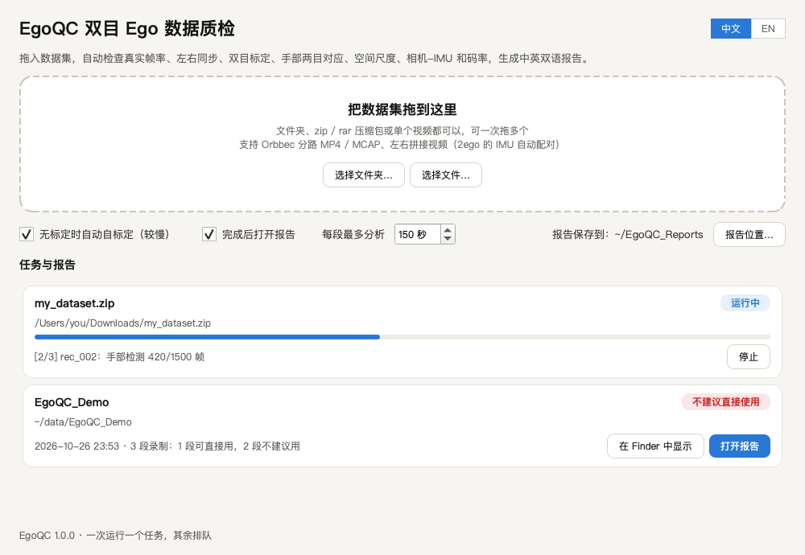
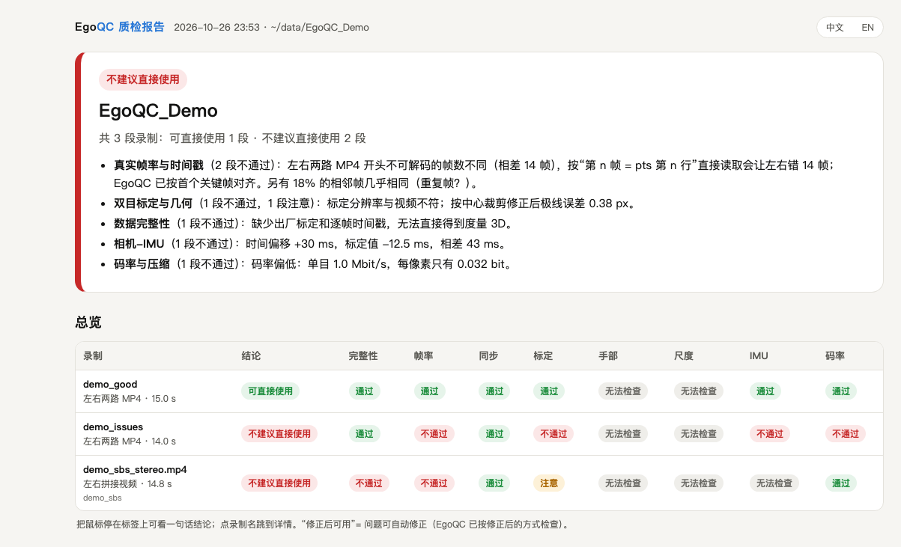
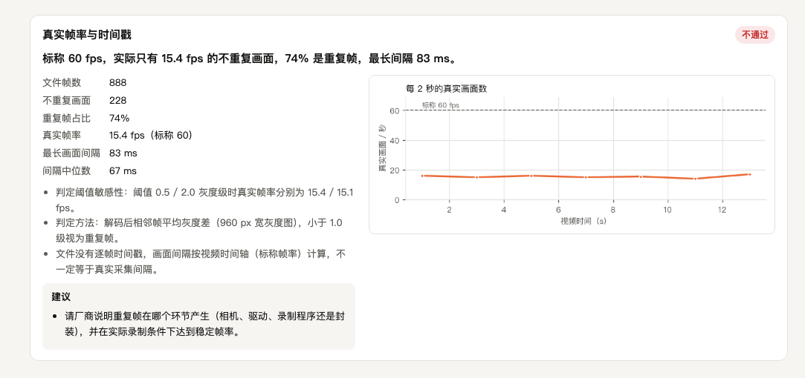
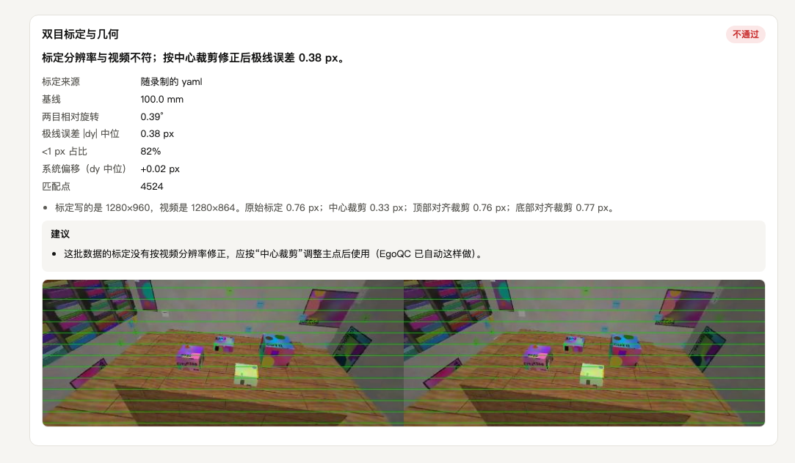
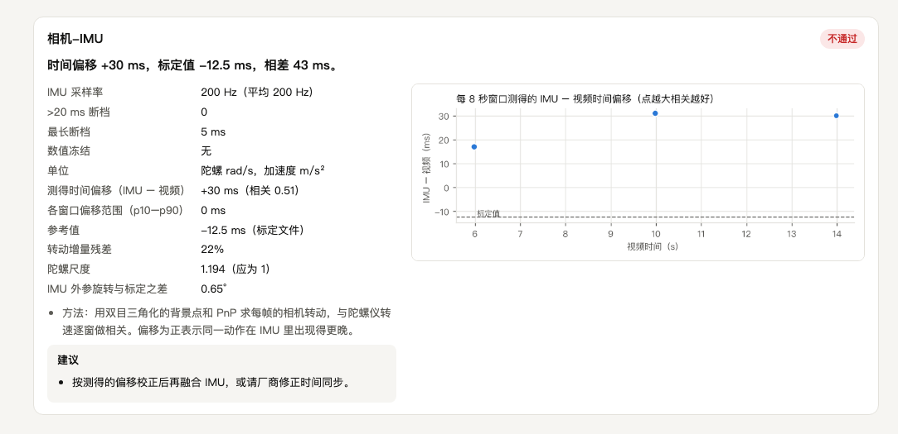
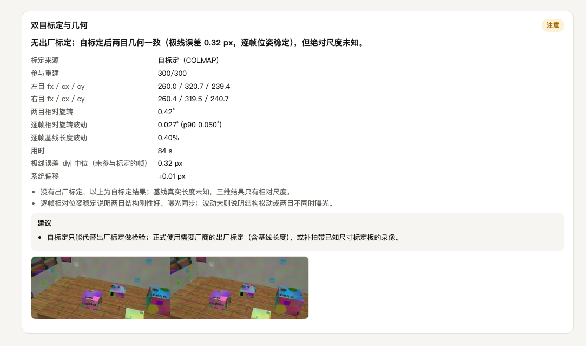

<p align="center"></p>

<h1 align="center">EgoQC</h1>
<p align="center"><b>双目第一视角（Ego）数据集质检工具：把数据集拖进去，就得到结论和一份看得懂的报告。</b><br>
<a href="README.md">English</a> · 中文</p>

头戴双目录的数据能不能用来学手部和工具动作，取决于几件事：画面是不是真实的帧、左右两目是否同步、标定和画面是否吻合、
两只眼睛看到的手是否一致、三维尺度对不对、IMU 和视频在时间上是否对齐。EgoQC 从录像本身把这些都测出来，而不是相信文件
元数据；每个数据集生成一份自带图片的 HTML 报告，中英双语（右上角切换）。



## 能查出什么

这些问题在元数据里看不出来，却会让三维手部/工具跟踪失效：

- 标称“60 fps”的视频，大部分帧其实是上一帧的重复
- 左右两路 MP4 从关键帧之前开始录，常规读法会让左右错开好几帧
- 给 1920×1080 视频配的是 1920×1200 的标定（主点差了一个裁剪量）
- IMU 时钟与标定里的时间偏移差几十毫秒，或者随时间漂移
- 码率太低，手指、工具尖糊成一片

每条结论都写明问题是什么、给出依据的数值，以及该向厂商要什么。

## 检查项

| 检查 | 怎么测 | 通过标准（`egoqc/config.py` 里可改） |
|---|---|---|
| 数据完整性 | 出厂标定、逐帧时间戳、IMU、元数据、标注文件 | 有标定和逐帧时间戳 |
| 真实帧率 | 不重复画面数：MJPEG 比较每帧字节指纹，H.264/H.265 比较解码后灰度差；断档；开头不可解码的帧 | ≥ 标称的 95%，最长间隔 ≤ 100 ms |
| 左右同步 | 左右时间戳差 + 两目运动互相关；拼接视频看两半是否同时更新 | 互相关峰值在 0 帧 |
| 双目标定 | 用标定做立体校正，统计 SIFT 匹配点的纵向误差（f = 500 px）；分辨率不符时自动尝试裁剪；没有标定时用 COLMAP 自标定 | 中位 ≤ 0.8 px，系统偏移 ≤ 0.4 px |
| 手部两目对应 | MediaPipe 在两目各自检测 21 个关键点，看两目关键点是否满足极线约束 | 检出 ≥ 90%，干净配对 ≥ 60% |
| 空间尺度 | 三角化的掌长（手腕 → 中指根关节）及其随深度的变化 | 7–10 cm，两手无同向的 > 10%/10 cm 趋势 |
| 相机-IMU | PnP 求相机转动，与陀螺仪逐窗相关：时间偏移、漂移、轴向、陀螺单位 | 与标定相差 ≤ 10 ms，各窗口相差 ≤ 50 ms |
| 码率 | 每个真实画面每像素的比特数 | H.264 ≥ 0.08，MJPEG ≥ 0.30 |

每段录制给出一个结论：**可直接使用**、**可用，有注意项**、**修正后可用**（问题能自动修正，EgoQC 已按修正后的数据检查）、
**不建议直接使用**。

## 报告

每个数据集一个 HTML 文件（图片内嵌，方便转发），另有给程序读的 `report.json`。开头是结论和主要问题，然后是每段录制一行的总览：



下面每项检查一张卡片，有数值、图和处理建议：

**真实帧率**：标称 60 fps 的左右拼接视频，每秒只有 15 个真实画面：



**双目标定**：给 1280×864 裁剪画面配的是 1280×960 的标定；EgoQC 找出裁剪方式并检验修正后的标定（绿线：校正后同一行应对上两目的同一特征）：



**相机-IMU**：IMU 时钟与标定里的时间偏移差 43 ms：



**自标定**：没有提供标定；COLMAP 从视频里恢复出两个镜头和双目结构：



<sub>截图来自下文的合成演示数据。</sub>

## 安装（macOS）

```bash
git clone https://github.com/KowalskiWang/EgoQC.git
cd EgoQC
brew install ffmpeg
packaging/setup.sh
```

`setup.sh` 会在 `.venv` 建 Python 3.12 环境（装了 [uv](https://github.com/astral-sh/uv) 就用 uv）、下载 MediaPipe 手部模型，
并生成 `~/Applications/EgoQC.app`。app 里放的是代码副本，改了代码要重跑 `packaging/make_app.sh`。在 macOS 15（Apple Silicon）上测试过。

## 使用

1. 打开 **EgoQC**，把数据集拖到窗口或 Dock 图标上：文件夹、zip / rar / 7z 压缩包或单个视频都可以，可一次拖多个，会排队逐个跑。
2. 窗口里能看进度；点“停止”会取消任务并删掉半成品。
3. 跑完自动打开报告（默认存到 `~/EgoQC_Reports`，可点“报告位置…”另选），之前的报告都列在窗口里。

第一次读移动硬盘时，macOS 会问是否允许 EgoQC 访问可移除宗卷，点“允许”即可（之后也可在 系统设置 → 隐私与安全性 → 文件与文件夹 里改）。

### 命令行（任何装了 Python 和 ffmpeg 的系统）

```bash
python egoqc_cli.py <文件夹 | 压缩包 | 视频> --out reports --lang zh
```

| 参数 | |
|---|---|
| `--out DIR` | 报告目录（默认 `~/EgoQC_Reports`） |
| `--lang zh\|en` | 报告打开时的语言，报告里可以切换 |
| `--max-seconds N` | 每段录制做重型检查时最多分析多少秒（默认 150） |
| `--no-selfcalib` | 没有标定时不做 COLMAP 自标定 |
| `--keep-work` | 保留解压出来的文件和中间结果 |

## 用演示数据试一试

```bash
.venv/bin/python demo/make_demo.py demo_data
```

几分钟内渲染出一个模拟头戴双目鱼眼相机（带 IMU）看到的带纹理房间，写出三段录制：`demo_good`（全部正确）、
`demo_issues`（埋了五个问题：左右两路错 14 帧、标定没按中心裁剪修正、IMU 时钟差 45 ms、20% 重复帧、每目约 1 Mbit/s）
和 `demo_sbs`（左右拼接视频，60 fps 的文件里只有约 15 fps 的真实画面，没有标定）。把 `demo_data` 拖进 EgoQC，报告会找出
所有埋下的问题；`demo_sbs` 的自标定与模拟镜头的真值相差约 0.3 px（焦距）和 0.2 px（主点）。合成场景里没有手，所以两项手部检查显示“无法检查”。

## 支持的数据

| 布局 | EgoQC 识别什么 |
|---|---|
| 左右分路 MP4 | `*camera_left*.mp4`、`*camera_right*.mp4`，各自旁边有 `*_pts.csv`（Orbbec Ego 录制程序的格式） |
| MCAP | `/camera/left`、`/camera/right` 上的 `foxglove.CompressedVideo`，IMU 在 `/imu…`（JSON 或 protobuf），标定是文件或 MCAP 附件 |
| 左右拼接视频 | 宽至少是高 2.5 倍的单个视频（如 3840×1080）；旁边的 2ego 格式 IMU 文件（`*_IMU_*.bin` + `_sync.csv`）自动配对 |

自己的录制设备，按下面的布局写出来就能用（`demo/make_demo.py` 生成的就是这个格式）：

```
my_recording/
  my_recording_camera_left.mp4           每目一个文件（H.264/H.265）
  my_recording_camera_left_pts.csv       第一行表头，之后每帧一个时间戳（微秒）
  my_recording_camera_right.mp4
  my_recording_camera_right_pts.csv
  my_recording_calibration_camera.yaml   两个 Kannala-Brandt 鱼眼相机 + 外参（格式见演示文件）
  my_recording_calibration_imu.yaml      可选：cam0.T_cam_imu、cam0.timeshift_cam_imu（Kalibr 约定）
  my_recording_imu.csv                   可选：timestamp_us,x,y,z,type（type = gyro [rad/s] | accel [m/s²]）
  meta_my_recording.json                 可选：设备名、序列号、固件、画面尺寸
```

没有标定文件时，EgoQC 从视频本身自标定（只有相对尺度）。

## 工作原理

```
app/egoqc_app.py      桌面窗口（PySide6）；每个任务起一个 egoqc_cli.py 进程并读取进度
egoqc_cli.py          命令行
egoqc/ingest.py       解压，找出录制及其布局
egoqc/sources.py      各种布局的画面、时间戳、标定和 IMU（统一成同步的左右帧对）
egoqc/checks/*.py     每项检查一个模块，返回状态、摘要、数值、建议和图
egoqc/runner.py       跑全部检查、给出结论、写 report.json / report.html
egoqc/report.py       中英双语 HTML 报告
demo/make_demo.py     合成演示数据
docs/make_screenshots.py  重新生成本说明里的截图
```

说明与局限：

- 手部和尺度两项需要画面里有手，并且有标定（出厂或自标定）。
- 自标定只能得到相对尺度；度量检查需要出厂标定。
- 阈值是按 1080p–1200p、30–60 fps 的头戴鱼眼双目设备调的。
- 手部关键点来自 MediaPipe，手部数值最好在场景相近的录制之间比较。

## 许可

MIT，见 [LICENSE](LICENSE)。使用了 [MediaPipe](https://github.com/google-ai-edge/mediapipe)（手部关键点模型，Apache-2.0）、
[COLMAP / pycolmap](https://github.com/colmap/colmap)（BSD）、[OpenCV](https://opencv.org)（Apache-2.0）、
[PySide6](https://doc.qt.io/qtforpython-6/)（LGPL-3.0）和 [FFmpeg](https://ffmpeg.org)。
